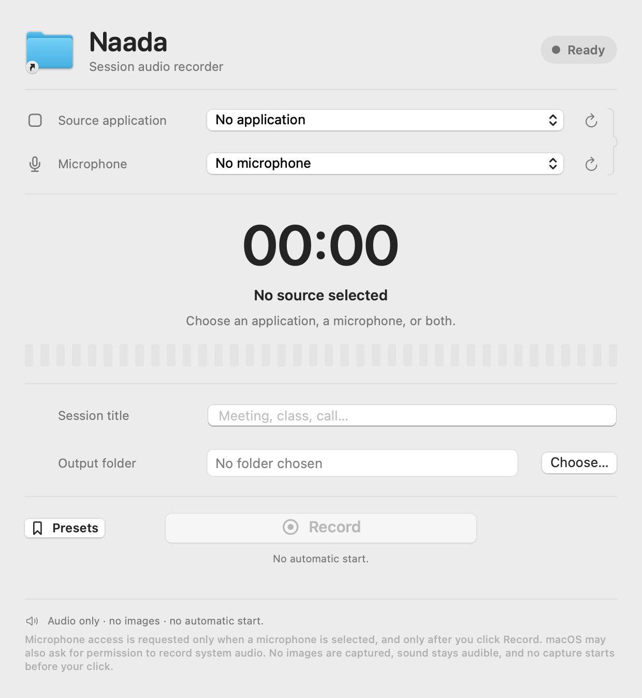

# Naada

Naada is a small, self-contained macOS app that records the audio of one open
application — or your microphone, or both — into an MP3 file, without
interrupting or rerouting the sound you hear.

Nothing starts by itself: pick a source and a folder, then click **Record**.



## Modes

| Mode | What is captured |
|---|---|
| Application only | The chosen application, through a private Core Audio process tap. Every other app, and the system output, is untouched. |
| Microphone only | The chosen input, or the system default input. No application audio. |
| Application and microphone | Both streams, mixed into a single MP3. |

In every mode the sound stays audible: Naada never mutes the captured
application and never changes the volume, the routing or the default output
device. Naada excludes its own audio from the capture.

## Permissions

Naada requests nothing at launch. No capture device is opened and no permission
dialog appears before you click **Record**.

- **System audio recording** — the first time you record an application, macOS
  may ask to allow it. Core Audio process taps need that authorization; the
  dialog is the audio-only one. Naada never captures images, windows or screen
  content.
- **Microphone** — requested only when a microphone is selected, and only after
  the click on **Record**. Application-only recordings never ask for it.

The app declares a single entitlement, `com.apple.security.device.audio-input`,
required for the microphone under the hardened runtime. It has no network
access, no account and no telemetry; files are written only to the folder you
choose.

## Language

English and French, selected automatically from the system language. Any other
system language falls back to English.

## Requirements

- macOS 14.2 or later (Core Audio process taps).
- Xcode command-line tools, Swift 5.9 or later.

## Build

```bash
git clone https://github.com/Smax2k/naada.git
cd naada
./scripts/build.sh          # produces ./Naada.app
open ./Naada.app
```

`./scripts/build.sh` assembles the bundle, compiles the icon, then signs it. It
requires the *Developer ID Application* certificate of team `BG55CF653X`; without
it the script stops with an explicit message and produces no bundle.

## Installation

Drag `Naada.app` into `/Applications`. Naada is a standard, self-contained app
bundle: no installer, no helper, no background service.

## Signature and Gatekeeper

Each build is signed **Developer ID Application** (team `BG55CF653X`) with the
hardened runtime and a secure timestamp, and its designated requirement is
pinned to the bundle identifier and the team — not to the CDHash — so rebuilding
keeps the same code requirement.

The build is **not notarized**: Apple has not reviewed it. A copy downloaded
from the internet (a release DMG, for example) carries the quarantine flag, so
the first launch is blocked by Gatekeeper with a message such as *“Naada” cannot
be opened because Apple cannot check it for malicious software.*

How to explain it to a user:

> The app is signed with a real Apple Developer ID, but the build was not
> submitted to Apple for notarization, so macOS refuses the first launch. Open
> the app once, dismiss the dialog, then go to **System Settings → Privacy &
> Security**, scroll to the Security section and click **Open Anyway** next to
> Naada, then authenticate. macOS remembers the choice for that copy of the app.
> Right-clicking the app and choosing **Open** also works on older macOS
> versions.

Never ask a user to disable Gatekeeper system-wide, to remove the quarantine
attribute, or to run the app as root: the per-app **Open Anyway** flow is the
supported path. If that button does not appear, the copy is not trusted on that
Mac — rebuild it locally rather than weakening the system.

## Usage

1. Choose an **application**, a **microphone**, or both.
2. Choose the **output folder** (`Choose…`). The last folder is remembered.
3. Adjust the **session title** (it defaults to the application name).
4. Click **Record**, then **Stop**.

Presets keep a source, a title and a folder together for repeat sessions.

The state comes from the capture engine: `Ready`, `Preparing`, `Recording`,
`Finalizing`, `Error`. The timer runs only while capturing and freezes when you
stop.

## Output files

Name: `YYYY MM DD <session title>.mp3`

```text
2026 11 12 Meeting.mp3
2026 11 12 Meeting (2).mp3
2026 11 12 Workshop - Q&A - episode 2.mp3
```

- `/` and `:` in the title become `-`; control characters and repeated spaces
  are normalized.
- A collision adds ` (2)`, ` (3)`, and so on **before** the extension. An
  existing file is never overwritten: creation uses `O_CREAT | O_EXCL`.
- Audio is MPEG-1 Layer III, 48 kHz, stereo, 192 kbit/s, encoded by the Shine
  encoder compiled into the app.
- No ID3 tag is written: the file name carries the date and the session title.

## Tests

```bash
./scripts/test.sh     # pure unit tests, no device, no capture
./scripts/check.sh    # tests + release build + audio path, signature and icon checks
```

The tests cover file naming and collisions without overwriting, preservation of
an existing file's bytes, the simulated state machine and its frozen timer, and
encoding a synthetic PCM buffer to MP3 that is then decoded back by Core Audio —
all without any real capture. `check.sh` additionally verifies the static audio
path (no screen capture, private tap, audio authorization strings, minimum
macOS 14.2), the localization parities, the Developer ID signature and the
compiled icon; it needs the signing certificate.

## Release

```bash
./scripts/dmg.sh                # build, then write dist/Naada.dmg
./scripts/dmg.sh --no-build     # package the existing ./Naada.app
```

The disk image is named `Naada`, contains only `Naada.app` and a link to
`/Applications`, and is written to `dist/Naada.dmg`. The signed DMG attached to
a GitHub release is the same build: signed, not notarized, so the Gatekeeper
note above applies.

## Project layout

| Path | Content |
|---|---|
| `Sources/Naada` | SwiftUI app: window, capture engine, catalogues. |
| `Sources/NaadaCore` | Pure, tested logic: naming, exclusive creation, clock, MP3 writer, PCM mix. |
| `Sources/CShine` | The Shine MP3 encoder, compiled statically. |
| `Tests/NaadaCoreTests` | Unit tests, no device and no capture. |
| `packaging` | `Info.plist`, entitlements, icon, `en`/`fr` localization tables. |
| `scripts` | `build.sh`, `test.sh`, `check.sh`, `dmg.sh`, audio proof harness. |
| `docs` | Design, verification log, notarization notes. |

## Documentation

- [`docs/DESIGN.md`](docs/DESIGN.md) — architecture, capture path, state machine, limits.
- [`docs/VERIFICATION.md`](docs/VERIFICATION.md) — what is proven, what remains unverified.
- [`docs/NOTARISATION.md`](docs/NOTARISATION.md) — notarization notes.
- [`CREDITS.md`](CREDITS.md) — MP3 encoder and license.

## Out of scope

Scheduling, audio editing, publishing, network, accounts, synchronization.
Naada records, and stops there.

## License

The Shine encoder is under the GNU LGPL-2 and is linked statically into
`Naada.app`; redistributing the bundle must follow that license — the
corresponding source is this repository. See [`CREDITS.md`](CREDITS.md).
